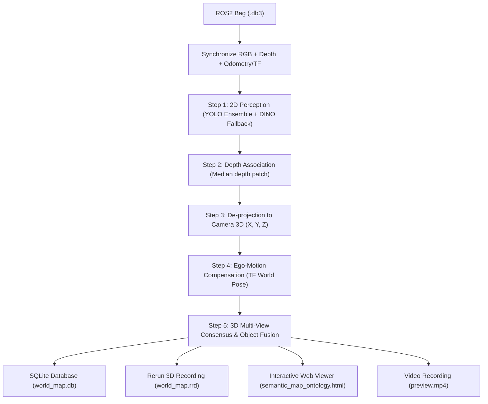

# 🗺️ 3D Semantic Mapping & Rerun Viewer — Guide & Run Commands

This guide explains how to build a persistent **3D Semantic Map** from recorded ROS2 RGB-D bags, filter out false detections using **3D Multi-View Consensus**, and visualize the navigable 3D environment in **Rerun** and your web browser.

---

## ⚡ Quick Start (Copy & Paste)

All commands must be run from the **project root folder** in PowerShell:
```powershell
cd "D:\Object Detection Model\yolo_tr\yolo_tr\Cognitive Recognition framework"
```

### 1. Build the Map (Fast & Complete)
```powershell
& ".\07_environment_and_project_meta\.venv-gpu311\Scripts\python.exe" `
  ".\01_codebase\08_semantic_map\build_semantic_map_from_bag.py" `
  --bag ".\02_datasets\kmi\rgbd_clean_20260925_134830-20261007T134658Z-1-002" `
  --frame-stride 3 `
  --merge-radius-m 0.5 `
  --min-consensus-hits 3 `
  --rerun `
  --rerun-cloud-stride 10 `
  --rerun-cloud-every 10
```

### 2. View in Rerun 3D Viewer
```powershell
& ".\07_environment_and_project_meta\.venv-gpu311\Scripts\rerun.exe" `
  ".\04_outputs_runs_and_logs\outputs\semantic_maps\rgbd_clean_20260925_134830\world_map.rrd"
```

### 3. View in Interactive Web Browser (Plotly HTML)
```powershell
& ".\07_environment_and_project_meta\.venv-gpu311\Scripts\python.exe" `
  ".\01_codebase\08_semantic_map\view_semantic_map.py" `
  --db ".\04_outputs_runs_and_logs\outputs\semantic_maps\rgbd_clean_20260925_134830\world_map.db" `
  --html
```

---

## 🧠 What Happens Under the Hood?



### How Multi-View Consensus Fixes Inaccurate Detections:
1. **Class-Agnostic 3D Spatial Fusion**: New detections search for existing 3D objects occupying the **same physical location** ($\le 0.5\,\text{m}$), regardless of what label the 2D detector predicted.
2. **Vote Histogram**: Each 3D object accumulates a confidence tally across all frames:
   $$\text{votes}[c] = \sum \text{confidence}(c)$$
3. **Consensus Winner**: The object's label is set to $\arg\max(\text{votes})$. If a single frame falsely detects `security_camera` (conf: 0.50), but 8 subsequent frames detect `doorstop` (conf: 0.85), `doorstop` wins with overwhelming confidence.
4. **Transient Filtering (`--min-consensus-hits 3`)**: Ghost detections that appear for only 1–2 frames are automatically excluded from the final map and Rerun output.

---

## 📋 Step-by-Step Workflow

### Step 1: Sanity Check & Help
Verify that the GPU environment and bag reader are working properly:
```powershell
& ".\07_environment_and_project_meta\.venv-gpu311\Scripts\python.exe" `
  ".\01_codebase\08_semantic_map\build_semantic_map_from_bag.py" --help
```

---

### Step 2: Quick Smoke Test (30 Frames)
Run a quick test on the first 30 frames to verify the TF tree, camera intrinsics, and depth alignment before processing the full dataset:
```powershell
& ".\07_environment_and_project_meta\.venv-gpu311\Scripts\python.exe" `
  ".\01_codebase\08_semantic_map\build_semantic_map_from_bag.py" `
  --bag ".\02_datasets\kmi\rgbd_clean_20260925_134830-20261007T134658Z-1-002" `
  --max-frames 30 `
  --rerun `
  --verbose
```

---

### Step 3: Full Run with Live Rerun Viewer (`--rerun-spawn`)
If you want the Rerun 3D desktop viewer window to **pop up immediately and visualize live** as the bag processes:
```powershell
& ".\07_environment_and_project_meta\.venv-gpu311\Scripts\python.exe" `
  ".\01_codebase\08_semantic_map\build_semantic_map_from_bag.py" `
  --bag ".\02_datasets\kmi\rgbd_clean_20260925_134830-20261007T134658Z-1-002" `
  --frame-stride 3 `
  --merge-radius-m 0.5 `
  --min-consensus-hits 3 `
  --rerun `
  --rerun-spawn `
  --rerun-cloud-stride 10 `
  --rerun-cloud-every 10
```

---

### Step 4: Inspecting What You See in Rerun

When you open `world_map.rrd` in the Rerun viewer:
1. **Scene Point Cloud (`world/map/cloud_*`)**:
   - The complete 3D environment with natural RGB colors and point-level semantic annotations.
   - Hovering over points shows their category:
     - **`Floor`**: Ground / drivable surface (specifically identified via RANSAC plane fitting and world $Z$ elevation; never lumped as Background).
     - **Object classes**: `fire_extinguisher`, `door`, `power_socket`, etc.
     - **`Background`**: Walls, ceilings, and distant structures.
2. **Navigable Floor Zone (`world/zones/*`)**:
   - **`world/zones/navigable_boundary`**: Continuous 3D line strip tracing the perimeter outline of the entire navigable floor area discovered by the robot.
   - **`world/zones/navigable_floor`**: 3D semi-transparent bounding box labeled strictly **`Floor`** (no instance IDs).
   - Metadata contains the exact navigable area in $\text{m}^2$, ground elevation $Z$, and spatial bounding box.
3. **Semantic Highlights (`world/map/semantic_cloud_*`)**:
   - Isolated 3D point clusters belonging specifically to detected objects, color-coded by class.
4. **3D Oriented Bounding Boxes (`world/landmarks/*`)**:
   - Sized from real measured depth data or typical ontology dimensions.
   - Clicking a box opens the **Metadata Panel** showing:
     - `map_class`: The consensus-winning object label.
     - `consensus_score`: Reliability percentage (e.g. `0.92`).
     - `class_votes`: Full vote distribution (e.g. `{"fire_extinguisher": 8.5, "power_socket": 0.4}`).
     - `ontology_hierarchy`: Full path in the RDF knowledge graph (e.g. `PhysicalObject > SafetyEquipment > fire_extinguisher`).
5. **Robot Path (`world/trajectory`)**:
   - Yellow 3D ribbon showing the robot's movement over time.
6. **Camera View (`world/camera/image`)**:
   - 3D frustum with the live synchronized RGB camera frames.

---

## 📁 Output Folder Structure

Every bag gets its own persistent folder under:
`04_outputs_runs_and_logs/outputs/semantic_maps/<bag_name>/`

```
04_outputs_runs_and_logs/outputs/semantic_maps/rgbd_clean_20260925_134830/
├── world_map.db                 # SQLite database (all landmarks + raw observations)
├── world_map.rrd                # Complete 3D Rerun scene recording
├── semantic_map_ontology.html   # Standalone interactive Plotly HTML viewer
├── preview.mp4                  # OpenCV video recording with 2D/3D overlays
├── run.log                      # Full debug log
├── latest_run.json              # Run manifest (topics, settings, statistics)
└── run_history/                 # Preserved previous runs and archived .rrd snapshots
```

---

## ⚙️ Command-Line Flags Reference

| Flag | Default | Description |
| :--- | :---: | :--- |
| `--bag` | *(required)* | Path to ROS2 bag folder (supports both outer unzipped folder and inner bag folder). |
| `--frame-stride` | `1` | Process every $N$-th frame (`3` processes $3\times$ faster while keeping full coverage). |
| `--merge-radius-m` | `0.5` | 3D radius (in metres). Detections within this distance are fused into a single persistent 3D node. |
| `--min-consensus-hits` | `1` | Minimum multi-view hits required before exporting a landmark to Rerun / HTML (`3` filters single-frame noise). |
| `--min-confidence` | `0.0` | Drop detections below this raw detector confidence. |
| `--rerun` | `False` | Generate and export the complete 3D `world_map.rrd` file. |
| `--rerun-spawn` | `False` | Automatically launch the Rerun viewer desktop app during processing. |
| `--rerun-cloud-stride` | `6` | Pixel stride for depth back-projection (`10` = lighter point cloud, faster loading). |
| `--rerun-cloud-every` | `5` | Add a depth cloud snapshot every $N$-th processed frame (`10` = optimized). |
| `--disable-dino` | `False` | Turn off Grounding DINO fallback (runs YOLO ensemble only, faster). |
| `--dino-interval` | `15` | Run Grounding DINO fallback every $N$-th frame (`1` = every frame, `15` = balanced). |
| `--no-preview` | `False` | Disable the OpenCV desktop preview window (useful for headless / background runs). |
| `--no-video` | `False` | Do not record `preview.mp4` to save disk space. |

---

## ❓ Frequently Asked Questions

### 1. What if I want to re-run on a different bag?
Just change the `--bag` argument to point to another dataset:
```powershell
--bag ".\02_datasets\saxon\rgbd_clean_20260521_142555"
```
The script will automatically detect the bag's topics, TF frames, and create a dedicated output folder for it.

### 2. Can I view previous runs together in Rerun?
Yes! To compare the current map against earlier recordings:
```powershell
& ".\07_environment_and_project_meta\.venv-gpu311\Scripts\rerun.exe" `
  (Get-ChildItem ".\04_outputs_runs_and_logs\outputs\semantic_maps\rgbd_clean_20260925_134830\run_history\world_map_*.rrd" | Select-Object -ExpandProperty FullName) `
  ".\04_outputs_runs_and_logs\outputs\semantic_maps\rgbd_clean_20260925_134830\world_map.rrd"
```

### 3. How do I filter out low-confidence landmarks in the HTML viewer?
In `view_semantic_map.py`, use the `--min-hits` flag:
```powershell
& ".\07_environment_and_project_meta\.venv-gpu311\Scripts\python.exe" `
  ".\01_codebase\08_semantic_map\view_semantic_map.py" `
  --db ".\04_outputs_runs_and_logs\outputs\semantic_maps\rgbd_clean_20260925_134830\world_map.db" `
  --min-hits 5 `
  --html
```
This hides any landmark that was detected fewer than 5 times.

